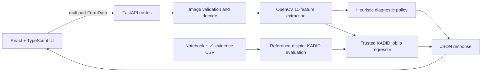

<div align="center">

# ProductPhoto QA

### Explainable Image-Quality Diagnostics for Product Photography

**Day 18 / 100 Days of Projects** · **Research MVP** · **React + TypeScript + FastAPI + OpenCV + scikit-learn**

[](https://www.python.org/) [](frontend/) [](backend/) [](backend/tests/) [](LICENSE)

**Upload a photo → inspect blur/exposure/contrast → estimate KADID perceptual quality → explain provisional review flags → export actual JSON.**

**Research warning:** This is **not** a calibrated marketplace acceptance classifier. `PASS_PROVISIONAL` is a heuristic diagnostic, **not a seller approval**, and KADID 1–5 is **not a probability**.

[Quick Start](#quick-start--windows-powershell) · [Evidence](#experimental-evidence) · [Gallery](#research-visualizations--assets) · [Architecture](docs/en/ARCHITECTURE.md) · [Bahasa Indonesia](docs/id/README.md) · [AGENTS](AGENTS.md)
</div>

---

## At a glance

| Dimension | Verified state | Boundary |
|---|---|---|
| Web application | React interface communicated with local FastAPI during manual testing | No public hosted deployment verified |
| Analysis API | `GET /api/v1/health`, `POST /api/v1/analyze` | Default local deployment; JPG/PNG/WEBP/BMP; 12 MiB max |
| KADID score | Serialized HistGradientBoosting model used in local API + CLI | Learned from synthetic distortions, not product labels |
| Automated backend checks | **10 passed, 1 Starlette deprecation warning** in user's Windows test | Not equivalent to comprehensive security or production testing |
| Offline evaluation | Held-out **1,625** reference-disjoint KADID images | No external marketplace test set |
| SPAQ | Six `.z01`–`.z06` parts and MOS spreadsheet inventoried | Missing `SPAQ.zip` terminal volume; **0 SPAQ photos evaluated** |
| Finegrain | **v1 repository report: 0** directly discovered photos; **separate v4.2 Kaggle log: 120** decoded from Parquet | Later outcome is **not** embedded in repository v1 `reports/final_summary.json` |
| Production frontend build | `npm run build` available | Successful build not yet evidenced in this documentation baseline |

## The problem

E-commerce sellers often need an understandable initial check of photos for possible blur or problematic lighting before manual review. A regression model trained on an unrelated image-quality dataset cannot responsibly declare that a product photo meets any marketplace's guidelines. ProductPhoto QA separates **measured diagnostics**, **perceptual score estimation**, and **decision policy**, and exposes their limitations rather than combining them into a misleading “accuracy” figure.

## Before → Now → Next

| Phase | State | Meaning |
|---|---|---|
| **Before** | Experiment in Kaggle | KADID image-quality scoring, split auditing, parameter selection, plotted evaluation. |
| **Now** | Functional local research MVP | Full-stack upload, image-feature extraction, KADID model inference, provisional policy, Swagger, CLI, JSON export, reproducible artifacts. |
| **Next** | Research and engineering hardening | Calibrated product labels, expanded product evaluation, security/operability checks, CI, real deployment, browser accessibility testing, SPAQ recovery only when complete photos exist. |

## Main capabilities

- **Drag & drop** or browse for a JPG, PNG, WEBP, or BMP; see preview, replace, reset.
- **Server-side analysis** with matching KADID-v1 preprocessing and eleven numerical descriptors.
- **Explainable rule flags**: `possible_blur`, `possibly_too_dark`, `possibly_too_bright`.
- **Independent learned estimate** of KADID synthetic-distortion quality in range 1–5 (when trusted model loads).
- **Live backend health indication**, loading/error states and real JSON export.
- **CLI** for a local photo and an evaluation helper for saved held-out predictions.
- **Explicit model-unavailable handling**: no fabricated AI scores.

## Research visualizations & assets

All three graphs below are **committed repository artifacts**, not generated claims. The graphics originate from the KADID v1 experiment; they are not plots of Finegrain acceptance accuracy.

### Held-out perceptual quality: observed vs predicted


*Predictions for reference-disjoint KADID test images. Values approximate perceived quality on the source dataset, not product approval.*

### Validation model comparison


*The champion was selected by validation MAE. The test partition was then evaluated separately.*

### Feature distributions


*Feature distributions are exploratory, not learned rejection thresholds.*

**Full asset inventory:** [docs/en/ASSETS.md](docs/en/ASSETS.md) · [docs/id/ASSETS.md](docs/id/ASSETS.md). UI screenshots and demonstration video are **not present in the audited GitHub tree**. Add authorized screenshots to `assets/screenshots/` before claiming them in the README. No screenshots or plots have been invented for this documentation update.

## System architecture



- `frontend/src/App.tsx`: application interaction and backend calls; `styles.css` handles layout and aspect ratio.
- `backend/app/api/routes.py`: `/health` and `/analyze`, content type and size checks.
- `backend/app/services/analysis.py`: service adapter.
- `backend/app/quality.py`: authoritative feature extraction, policy, trusted model loading and scoring.
- `backend/app/core/config.py`: 12 MiB upload cap and allowed localhost CORS origins.
- `ml/inference/predict.py`: CLI reuse of backend quality logic.
- `ml/evaluation/metrics.py`: re-evaluate saved v1 held-out CSV.
- `notebooks/productphoto-qa.ipynb`: source experiment; `reports/` and `exports/` preserve evidence.

See [detailed architecture](docs/en/ARCHITECTURE.md) and [Indonesian architecture](docs/id/ARCHITECTURE.md).

## Repository structure (audited against GitHub `main`)

```text
ProductPhoto-QA/
├── AGENTS.md                       # contributor/AI agent rules (from this docs package)
├── README.md                       # comprehensive entry point
├── LICENSE                         # MIT for repository-owned software
├── .gitignore
├── backend/
│   ├── README.md
│   ├── requirements.txt
│   ├── app/
│   │   ├── main.py                 # FastAPI app and CORS
│   │   ├── quality.py              # v1 features/policy/model loader
│   │   ├── api/routes.py           # health and analyze
│   │   ├── core/config.py          # upload and origin settings
│   │   └── services/analysis.py
│   └── tests/{test_api.py,test_architecture.py}
├── frontend/
│   ├── README.md
│   ├── package.json                # npm dev/build/preview
│   ├── package-lock.json
│   ├── .env.example
│   └── src/{App.tsx,main.tsx,styles.css}
├── ml/
│   ├── inference/predict.py
│   └── evaluation/{metrics.py,audit.py}
├── models/{kadid_quality_proxy.joblib,model_config.json}
├── notebooks/productphoto-qa.ipynb
├── exports/kadid_heldout_predictions.csv
├── reports/                       # machine-generated v1 evidence (see table below)
├── assets/plots/                   # 3 actual PNG charts
└── docs/
    ├── id/                        # Indonesian operator/research docs
    └── en/                        # English operator/research docs
```

`AGENTS.md` and the expanded documentation in the ZIP are **proposed local additions**, not yet committed to GitHub. Files such as `assets/screenshots/` and `.github/workflows/` are future additions, not currently present.

## Quick Start — Windows PowerShell

**Prerequisites:** Python 3.11, Node.js and npm, trusted `models/*.joblib`, working directory at repo root. Default API and UI run on localhost only.

```powershell
# From a parent folder, clone once (do not clone inside existing initialized repo)
git clone https://github.com/MENSTRUE/ProductPhoto-QA.git
cd ProductPhoto-QA

# Terminal A — Python API
cd backend
py -3.11 -m venv .venv
.\.venv\Scripts\python.exe -m pip install -r requirements.txt
.\.venv\Scripts\python.exe -m pytest -q
.\.venv\Scripts\python.exe -m uvicorn app.main:app --reload
```

Open `http://127.0.0.1:8000/docs`, call `GET /api/v1/health` and verify `model_loaded: true`. In a **second terminal**:

```powershell
cd frontend
npm ci
npm run dev
```

Open `http://127.0.0.1:5173`; upload a **local authorized product photo**, analyze, inspect recommendation vs quality estimate, export JSON. With Vite running in the second terminal, keep Uvicorn running in the first.

### Offline tools (from repository root)

```powershell
backend\.venv\Scripts\python.exe -m ml.evaluation.metrics --predictions exports/kadid_heldout_predictions.csv
backend\.venv\Scripts\python.exe -m ml.inference.predict "C:\Users\Asus\OneDrive\Pictures\produk.jpg"
```

The example photo path is **illustrative and user-specific**; replace with an existing image on your own machine. Run Python CLI from repository root so `ml` is importable. [Reproducibility details](docs/en/REPRODUCIBILITY.md).

### API examples

```powershell
Invoke-RestMethod http://127.0.0.1:8000/api/v1/health

# Windows curl.exe (not the Invoke-WebRequest alias)
curl.exe -X POST http://127.0.0.1:8000/api/v1/analyze -F "file=@C:\path\to\photo.jpg"
```

Status `200` for a valid image; unsupported media `415`, empty file `400`, file too large `413`, unreadable image `422`. The response contains `filename`, `status`, `reasons`, `metrics`, `quality_estimate`, and `disclaimer`. **Example results in docs are illustrative unless identified as recorded evidence.** [API contract](docs/en/API.md).

## Experimental evidence

### KADID-10k v1, source-reference-disjoint split

| Indicator | Recorded value |
|---|---:|
| Total labeled images | 10,125 |
| Original source reference images | 81 |
| Train | 6,875 images / 55 groups |
| Validation | 1,625 images / 13 groups |
| Test | 1,625 images / 13 groups |
| Selected model | HistGradientBoostingRegressor |
| Test MAE ↓ | **0.768295** |
| Test RMSE ↓ | **0.966904** |
| Test R² ↑ | **0.192518** |
| Failed KADID feature reads | 0 |

The held-out test was not used to select the champion; v1 `histgb` validation MAE was **0.819218**, vs Ridge **0.900279** and Dummy **0.934277**. This is a **modest baseline** (R² ≈ 0.19), not a state-of-the-art or marketplace performance claim.

### Dataset evidence & the SPAQ incident

| Source | Contents and role | Actually tested | Limits |
|---|---|---|---|
| **KADID-10k** | 1–5 subjective score of synthetic distortions; 81 references | Full v1 feature extraction and grouped regression | Domain shift to product photography |
| **Finegrain Products** | Real product-photo Parquet data, no verified quality acceptance labels | Repo v1: **0** direct image smoke rows. Separately observed v4.2 notebook: **120** Parquet photos decoded | Not part of v1 repository metrics; flags are not an accuracy measurement |
| **SPAQ** | 11,125 MOS metadata entries; multi-volume photo archive | Metadata inventoried; **0 original images matched/decoded** | Mounted `.z01`–`.z06`, **missing `SPAQ.zip`**; 7z recovery timed out in later trial |

A file being inventoried does **not** mean it was trained on or evaluated. The v1 GitHub reports are authoritative for the displayed v1 MAE/RMSE/R². Other experiment results may be discussed **with their run identifier** but may not overwrite the v1 benchmark numbers without a provenance-aware new report. See [research audit](docs/en/EXPERIMENTS.md), [claims](docs/en/CLAIMS.md).

### Evidence ledger (tracked files)

| Evidence | Purpose |
|---|---|
| `reports/final_summary.json` | Canonical v1 research summary |
| `reports/kadid_heldout_metrics.json` | Source-group test metrics |
| `reports/split_audit.json` | Train/val/test group counts |
| `reports/model_selection.csv` | Validation-only champion selection |
| `reports/kadid_image_failures.json` | Failed KADID feature reads |
| `reports/inference_parity.json` | Saved model reload parity |
| `reports/finegrain_audit.json` | **v1: 0 decoded**; later 120 from separate run |
| `reports/spaq_audit.json` | **No SPAQ image evaluation** |
| `reports/policy.json` | Uncalibrated illustrative decision thresholds |
| `reports/source_inventory.csv` | Dataset file inventory at experiment time |
| `exports/kadid_heldout_predictions.csv` | Real held-out observed and predicted scores |

## How scores and policy differ

**KADID score:** fitted regression from 11 handcrafted OpenCV features; 1–5 within its source label scale. **Status:** independent hard-coded diagnostic thresholds for blur and brightness. Therefore an image may have `PASS_PROVISIONAL` and an estimated score near 2.2/5 without logical contradiction. The two values answer **different questions** and neither measures verified merchant acceptance.

The eleven features in order:

`laplacian_var`, `tenengrad`, `brightness_mean`, `brightness_std`, `dark_fraction`, `bright_fraction`, `contrast_p95_p5`, `colorfulness`, `entropy`, `width`, `height`.

Preprocessing: OpenCV decode BGR; resize longest edge to at most 640 using `INTER_AREA`; compute descriptors; retain original width/height. Any change in ordering, resize rounding or threshold breaks the inference contract and requires re-validation.

## Testing and quality gates

```powershell
# Backend test suite (recorded local run: 10 passed, 1 Starlette deprecation warning)
cd backend
.\.venv\Scripts\python.exe -m pytest -q

# Frontend, in its own directory
cd ..\frontend
npm ci
npm run build

# Git hygiene, from repo root
cd ..
git status --short
git ls-files | Select-String '\\.venv|node_modules|(^|/)dist/|(^|/)uploads/'
```

CI, end-to-end browser automation, and production infrastructure are **not represented as complete**. See [testing plan](docs/en/TESTING.md).

## Configuration and deployment

- The frontend uses `VITE_API_BASE_URL` (`frontend/.env.example`) to locate the API. Vite requires a restart after changing `.env`.
- FastAPI's current CORS allow-list includes `localhost:5173` and `127.0.0.1:5173`. Configure appropriate production origins **in code or managed configuration** before public hosting.
- Keep `PRODUCTPHOTO_MODEL_PATH` and `PRODUCTPHOTO_CONFIG_PATH` pointed at locally trusted version-matched artifacts.
- **Never** expose `uvicorn --reload` or a permissive upload API directly on the public Internet. Add request limits, rate limits, logging, security policies, proxy/TLS, monitoring, and operational review.
- A Vite build produces static `frontend/dist/`; it does not automatically deploy the backend.

[Deployment checklist](docs/en/DEPLOYMENT.md) · [Troubleshooting](docs/en/TROUBLESHOOTING.md).

## Limitations / claim boundaries

**Allowed:** “functional local research MVP”; “10 backend tests passed in the recorded local test”; “held-out KADID MAE 0.7683”; “heuristic blur and lighting diagnostics”; “real React to FastAPI and CLI inference.”

**Not allowed:** “98% product accuracy”, “approved by marketplace”, “trained on all three datasets”, “SPAQ MOS benchmark completed”, “Finegrain quality classifier”, “production ready”, “deployed publicly” or “calibrated PASS/FAIL model” without corresponding evidence.

For exact rules, consult [claim boundaries](docs/en/CLAIMS.md) and [AGENTS.md](AGENTS.md).

## Roadmap

| Priority | Workstream | Exit criterion |
|---|---|---|
| P0 | Close documentation and Git hygiene | Links valid, assets present, no private data committed |
| P0 | Frontend build and manual UI regression | `npm run build` passes and upload/preview/display works |
| P1 | Source provenance | Separate v1/v4.2 evidence files and manifest |
| P1 | Sampled product evaluation | Human-labeled product photos; report per-condition errors |
| P1 | Cross-domain quality research | Explicit product split, calibrated ranges, performance comparison |
| P1 | API hardening and CI | Security policy, limits, reproducible checks, GitHub Actions |
| P2 | SPAQ independent MOS experiment | Authentic accessible photos matched to MOS, distinct evaluation |
| P2 | Public staging deployment | TLS, CORS, logging, monitoring and privacy validation |
| P2 | Better explanation UX | Examples, threshold transparency, accessibility audit |

## FAQ and troubleshooting

**Why PASS but score 2.2069?** Policy and KADID regression are separate outputs, neither determines marketplace acceptance.

**Why isn't SPAQ training included?** The archive on Kaggle lacks the terminal `SPAQ.zip`; no corresponding original photos were decoded, so labels alone do not support MOS image regression.

**Why did Finegrain show 0 and later 120?** v1 only sought loose image files; later code decoded Parquet. Both outcomes must retain their run versions.

**Why does local CLI say image not found?** Supply a real absolute path; OneDrive Pictures can differ from `$HOME\\Pictures`.

**Why can pytest pass with a warning?** Current Starlette/httpx deprecation warning does not fail the tested assertions. Track dependency upgrades separately.

**Why is scikit-learn pinned?** The serialized model was built with scikit-learn 1.6.1; pin reduces incompatible unpickling risk. Only load trusted joblib.

**Why is the image preview squeezed?** Preserve intrinsic ratio and `object-fit: contain`; avoid fixed-height `cover` crops for originals.

More: [full FAQ](docs/en/FAQ.md) · [troubleshooting](docs/en/TROUBLESHOOTING.md).

## License, data and credits

The checked-in `LICENSE` applies the **MIT License** to repository-owned code (copyright 2026 as listed there). It does **not** relicense third-party KADID, SPAQ, Finegrain images, model dependencies, external screenshots, or datasets. Follow each provider's usage and attribution terms independently; no raw source datasets should be committed. Serialized models are unsafe to deserialize from unknown sources. Do not publish personal photo samples without permission.

The repo is owned by [MENSTRUE](https://github.com/MENSTRUE/ProductPhoto-QA). For contribution conventions and safe maintenance instructions, see [AGENTS.md](AGENTS.md) and [docs/en/CONTRIBUTING.md](docs/en/CONTRIBUTING.md).
