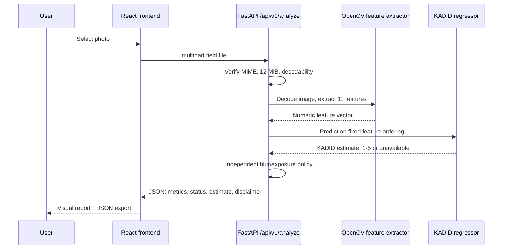

# Architecture and data flow

## Before / Now / Next

**Before:** one Kaggle notebook and local model outputs. **Now:** React/Vite UI, FastAPI API, shared OpenCV feature pipeline, joblib KADID model, Python CLI, evidence CSV and tests. **Next:** managed CI, human labels and publicly deployable security posture.

## Components and responsibilities

- `frontend/src/App.tsx`: file selection/validation, upload via FormData, API health, result rendering and JSON download; it does **not** implement a second scoring engine.
- `frontend/src/styles.css`: responsive visual presentation; photo preview should use uncropped natural proportions.
- `backend/app/main.py`: app creation and CORS; default allowed origins `http://localhost:5173`, `http://127.0.0.1:5173`.
- `backend/app/api/routes.py`: HTTP input handling; 12 MiB bytes read ceiling; MIME + read validation; errors 400/413/415/422.
- `backend/app/services/analysis.py`: service adapter used by routes.
- `backend/app/quality.py`: source-of-truth for `decode_image`, `extract_features`, `evaluate_policy`, model/config loading and analysis.
- `models/model_config.json`: 11-feature ordering and heuristic policy; model `models/kadid_quality_proxy.joblib` is trusted local artifact.
- `ml/inference/predict.py`: CLI using shared analysis contract; `ml/evaluation/metrics.py`: scores saved predictions.

## Feature computation invariants

BGR OpenCV decode; if longer edge >640 pixels, resize with `INTER_AREA`, dimension via `int(original * ratio)` (minimum 1). Gray metrics and colorfulness computed on resized image. Width/height retained **before** resize. The eleven features (strict order) are: `laplacian_var`, `tenengrad`, `brightness_mean`, `brightness_std`, `dark_fraction`, `bright_fraction`, `contrast_p95_p5`, `colorfulness`, `entropy`, `width`, `height`.

`laplacian_var` = variance of Laplacian; `tenengrad` = mean squared Sobel response. `dark_fraction` counts grayscale <45; `bright_fraction` counts grayscale >215. Contrast = grayscale P95–P5; entropy = Shannon entropy of normalized 256-bin grayscale histogram. These are image-content-sensitive proxies.

## Policy versus ML

`REVIEW` if Laplacian <75, brightness <65 or >205, dark fraction >0.48 or bright fraction >0.48; else `PASS_PROVISIONAL`. Score estimate comes from KADID trained regressor and is **not a threshold for this policy**. A low-ish KADID estimate and `PASS_PROVISIONAL` can coexist.

## Technical debt

Some `backend/app/quality.py` logic mixes preprocessing with scoring. Refactors must preserve exact response structure and feature parity; improve separation only with tests. There is no cloud datastore, async job queue, authentication, or managed file storage in this audited MVP.
