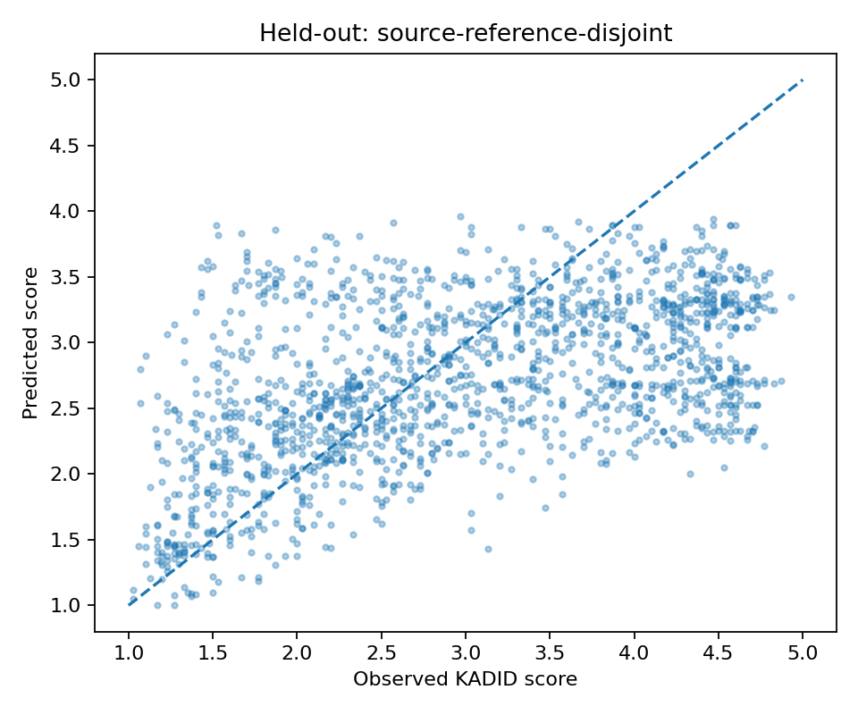
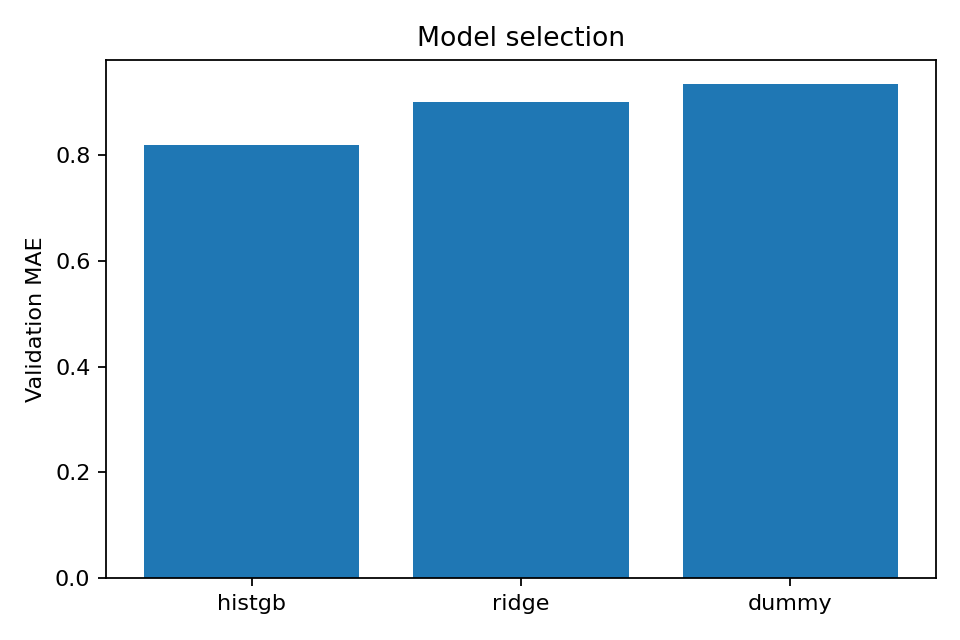
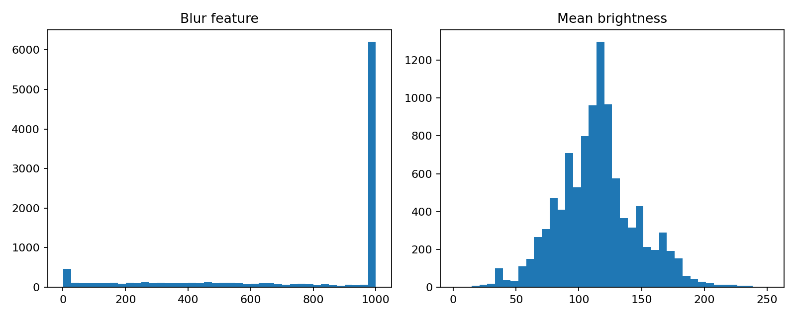

# Asset and report catalog

## Audited tracked visual assets

| File | Type | Exact evidence | GitHub embed |
|---|---|---|---|
| `assets/plots/heldout_quality_scatter.png` | PNG | Held-out KADID observed versus predicted score |  |
| `assets/plots/validation_comparison.png` | PNG | Validation MAE across candidate models |  |
| `assets/plots/image_feature_distribution.png` | PNG | KADID features exploratory histogram |  |

These are **all three real PNG plot files found in the current GitHub `main` tree** when this documentation was drafted. `assets/.gitkeep` is an empty placeholder. No logo, UI screenshot, user-photo sample or GIF/demo movie was verified in `assets/`. Therefore this package does not invent or embed them.

## Data/model/evidence assets

- `models/kadid_quality_proxy.joblib`: serialized KADID v1 model; do not load an arbitrary binary.
- `models/model_config.json`: model config, policy and **ordered 11 features**.
- `exports/kadid_heldout_predictions.csv`: prediction evidence (1,625 held-out images).
- `reports/final_summary.json`, `reports/kadid_heldout_metrics.json`, `reports/split_audit.json`, `reports/model_selection.csv`: experiment provenance.
- `reports/policy.json`, `reports/inference_parity.json`, `reports/kadid_image_failures.json`, `reports/source_inventory.csv`, `reports/spaq_audit.json`, `reports/finegrain_audit.json`: remaining v1 machine-generated audit.
- `notebooks/productphoto-qa.ipynb`: source notebook and its existing embedded outputs.

## Adding screenshot assets correctly

1. Capture **actual** local frontend at intended desktop width and mobile viewport; ensure private paths, tabs, emails, upload filenames and secrets are obscured.
2. Save to `assets/screenshots/dashboard-desktop.png`, `assets/screenshots/dashboard-mobile.png`, `assets/screenshots/analysis-result.png` only once real files exist.
3. Verify no copyrighted personal/source datasets are republished without permission.
4. Only then add relative embeds in root README and asset manifest. Do **not** replace experimental plots with staged mock screenshots.

## Linking conventions

Use repository-relative GitHub Markdown paths. `README.md` uses `assets/plots/...`, docs under `docs/en/` use `../../assets/plots/...`. Avoid `C:\\Users\\...` image links, local host URLs for actual image embeds or fabricated image URLs.
