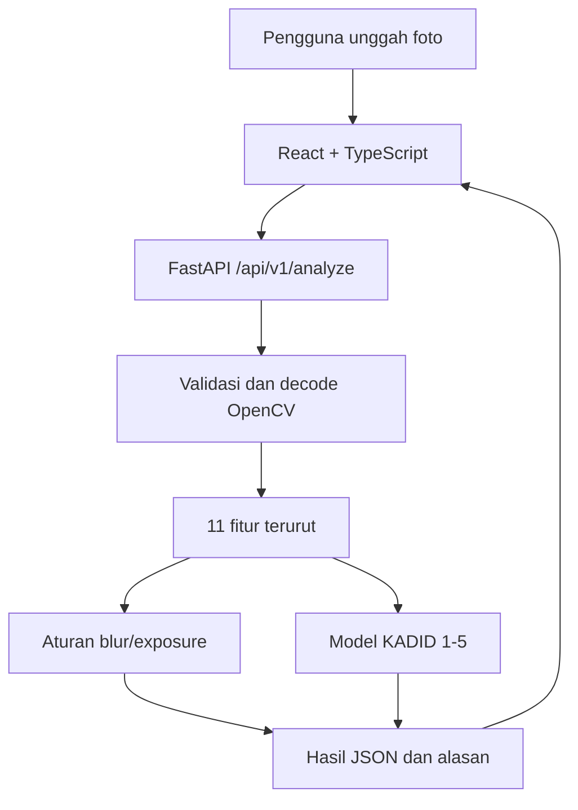

# Arsitektur ProductPhoto QA

## Before–Now–Next

**Before:** eksperimen KADID di Kaggle beserta model dan laporan. **Now:** UI React/TypeScript, backend FastAPI, fitur OpenCV, prediksi KADID dari joblib, CLI, dan tes otomatis. **Next:** label kualitas foto produk yang tervalidasi, CI, serta hardening keamanan dan deployment.

`backend/app/quality.py` menjadi sumber utama preprocessing dan inferensi. `backend/app/api/routes.py` membatasi MIME dan unggahan maksimal 12 MiB; `core/config.py` mengatur origin CORS lokal; `services/analysis.py` meneruskan permintaan. `frontend/src/App.tsx` menampilkan **respons API nyata**, tidak menebak skor model. `ml/inference/predict.py` memanfaatkan logika yang sama untuk CLI.

### Kontrak 11 fitur wajib

Urutan: `laplacian_var`, `tenengrad`, `brightness_mean`, `brightness_std`, `dark_fraction`, `bright_fraction`, `contrast_p95_p5`, `colorfulness`, `entropy`, `width`, `height`. Foto di-decode OpenCV BGR; sisi terpanjang maksimal 640 piksel menggunakan `INTER_AREA` dan pembulatan turun `int`, sedangkan lebar/tinggi keluaran fitur tetap dimensi asli.

Aturan `PASS_PROVISIONAL/REVIEW`: Laplacian minimum 75; brightness rata-rata 65–205; rasio piksel gelap dan terang masing-masing maksimum 0,48. Aturan ilustratif ini **berbeda dari prediksi KADID**, sehingga `PASS_PROVISIONAL` dengan skor model 2,2/5 bukan kontradiksi implementasi.

Sistem ini belum memiliki database produksi, login, cloud hosting maupun persetujuan marketplace. Jangan mengaku sudah ada. [Detail Inggris](../en/ARCHITECTURE.md).
